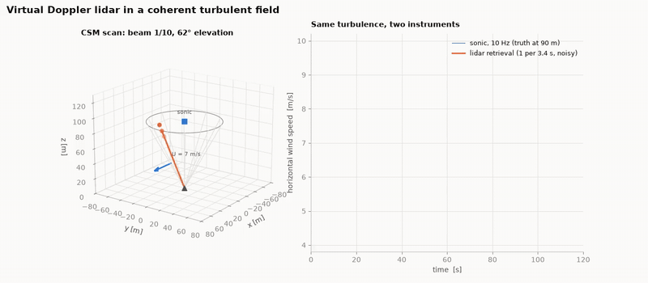
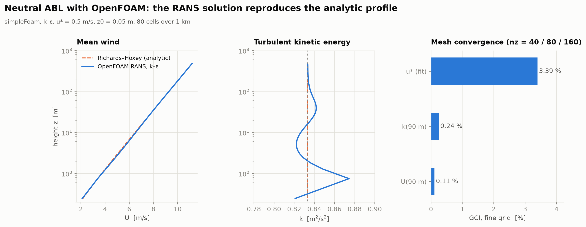
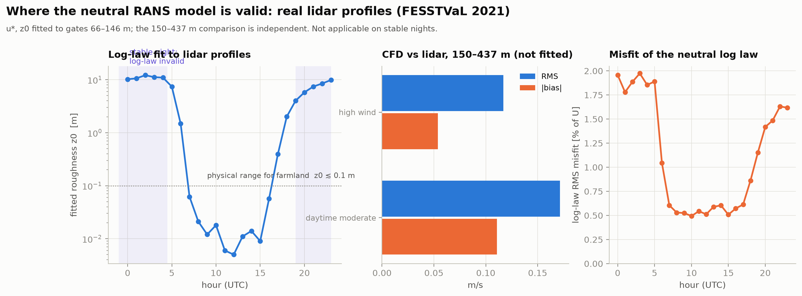
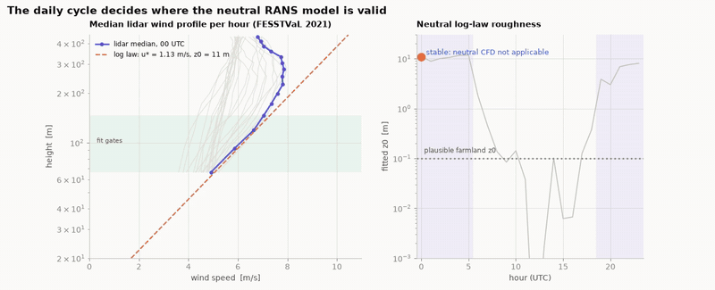
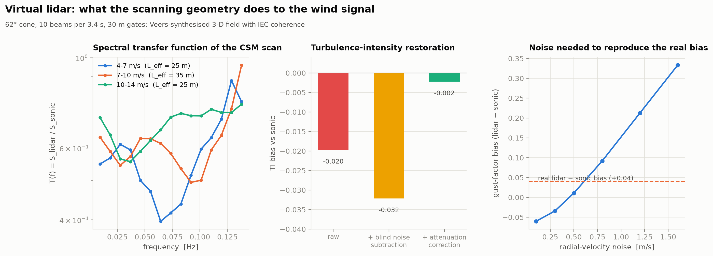
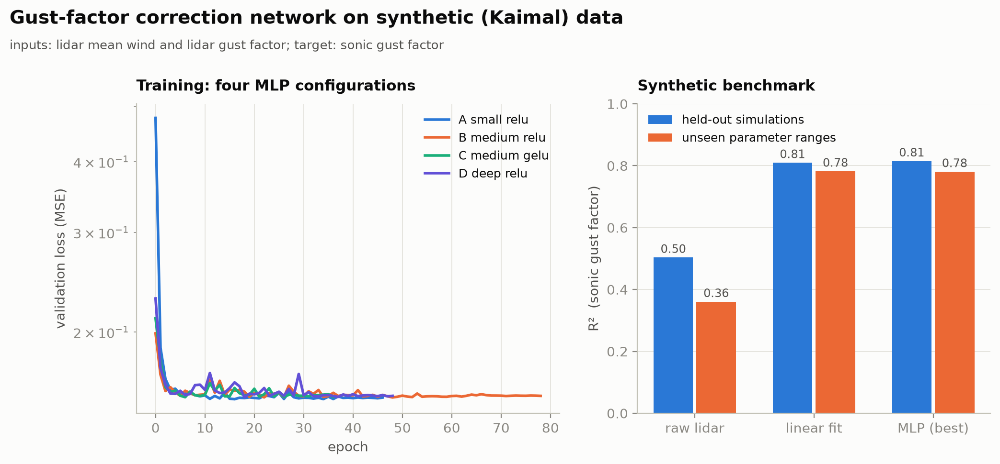
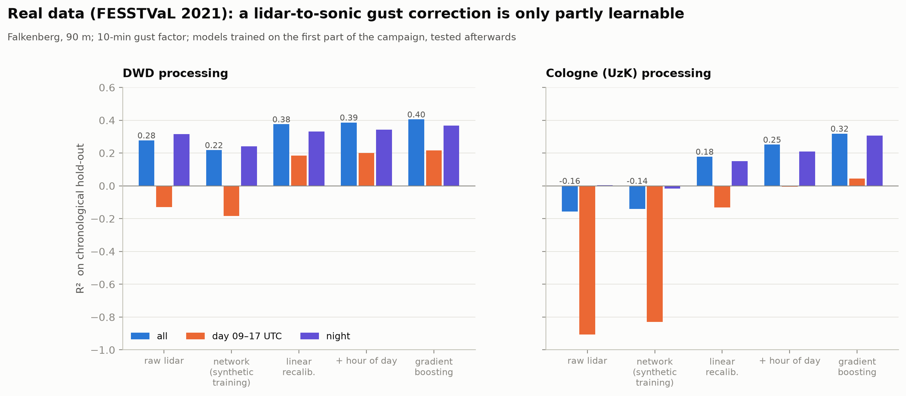
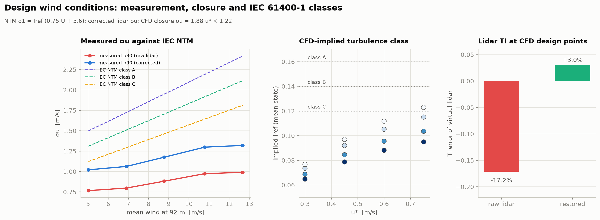
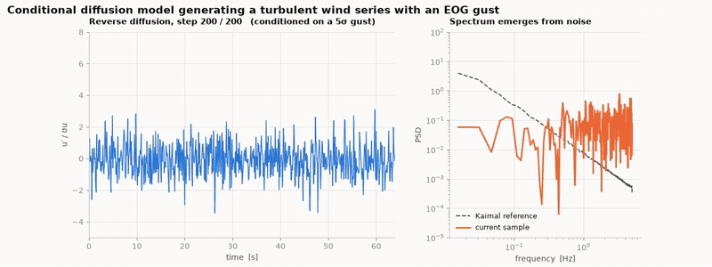
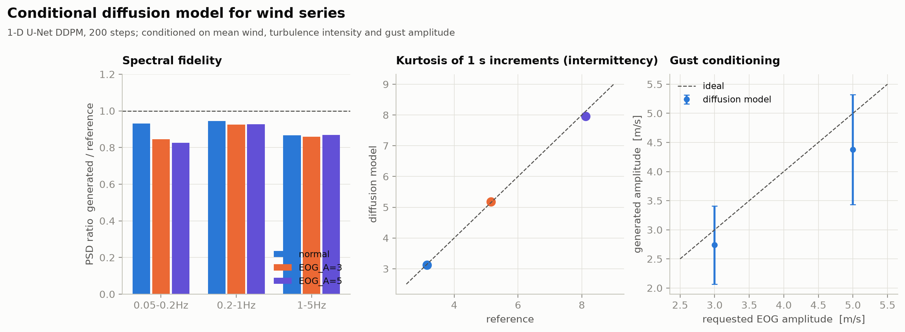

# windlidar

**Doppler-lidar signal processing, wind-field generation and design wind conditions: a virtual lidar, an OpenFOAM atmospheric-boundary-layer model and real FESSTVaL 2021 measurements in one reproducible code base.**

> Made with AI assistance (Claude).



*A conically scanning lidar samples a coherent turbulent field; the retrieved wind speed is compared with a sonic anemometer at the cone centre ([MP4](docs/media/virtual_lidar_scan.mp4)).*

---

## 1. What this project is, and why I built it

I wanted to understand what a scanning wind lidar can and cannot tell you about turbulence and gusts, and how that connects to simulation and to design wind conditions. The project grew in three steps:

1. **Start.** A neutral atmospheric boundary layer in OpenFOAM (RANS) as a verification case, plus a simple lidar/sonic emulator and a small neural network that corrects the lidar gust factor towards the sonic value.
2. **Real data.** I tested that network on the FESSTVaL 2021 campaign (Falkenberg, 90 m). It did **not** work as built, so I diagnosed why, fixed one emulator parameter, and tried a stability-aware emulator (which did not help further).
3. **Reframing.** The remaining error came from how the lidar measures, not from the network. I therefore built a beam-level virtual lidar (signal processing), added IEC 61400-1 design-condition checks, a conditional diffusion model for wind-series generation, and linked the CFD back in by validating it against real lidar profiles and using it as the turbulence closure for the design and lidar checks.

The project is **not** a validated measurement or certification tool. It is a worked study with honest limits, listed in section 5.

## 2. Contents

| Module | Purpose |
|---|---|
| `windlidar.atmosphere` | Kaimal spectra, Taylor frozen turbulence, Monin–Obukhov stability |
| `windlidar.lidar` | Virtual lidar (spectral synthesis with IEC coherence, CSM scan, VAD retrieval); a simple gust-factor emulator |
| `windlidar.cfd` | OpenFOAM case builder, post-processing, mesh study (GCI), parameter sweep, CFD-to-lidar validation and closure check |
| `windlidar.gustnet` | Synthetic datasets, MLP gust-factor correction, uncertainty propagation, emulator calibration |
| `windlidar.fesstval` | Quality-controlled sonic/lidar matching and evaluation on FESSTVaL 2021 level-2 data |
| `windlidar.generation` | Conditional diffusion model (1-D U-Net DDPM) for wind series with IEC EOG gusts |
| `windlidar.design` | IEC 61400-1 NTM / ETM / EOG / EWM and checks against measurements |
| `windlidar.studies` | Reproducible experiments: signal processing, noise sweep, stability ablation |
| `openfoam/` | OpenFOAM template (`system/`, `constant/`) and `Allrun*` scripts |

## 3. Design choices and the reasons for them

| Choice | Why | Cost |
|---|---|---|
| Neutral RANS k–ε with Richards–Hoxey inlet | Analytic solution exists, so I can verify the solver set-up; cheap on a laptop | k is fixed by the boundary conditions, so the CFD gives no independent turbulence information |
| Target = **gust factor** (3 s maximum / 10 min mean) | The public FESSTVaL sonic level-2 product has only means and gust maxima | A single 10-min maximum is a stochastic extreme, which limits achievable R² |
| Kaimal spectrum, Taylor's hypothesis | IEC reference spectrum; one length scale, one variance | Neutral, stationary, Gaussian; real turbulence is not |
| Simple emulator first, beam-level virtual lidar later | The emulator is fast enough to generate thousands of training records; the virtual lidar answers geometry questions | The emulator needs an assumed averaging length |
| Small MLP (2–3 inputs) | The mapping is smooth and low-dimensional; larger models only fit gust noise | Cannot learn anything the inputs do not contain |
| **Chronological hold-out and blocked cross-validation** | 10-min records are strongly autocorrelated; random splits leak and inflate scores | Fewer independent samples, noisy fold scores |
| Calibrate emulator parameters on the training period only | Avoids leaking test information | Calibration transfers imperfectly (worse for the Cologne product) |
| Report negative results | They explain what limits the approach | – |

## 4. Results

Every number below comes from this repository's runs. The complete write-up, including the first failed attempt, is in [`docs/EXPERIMENT_LOG.md`](docs/EXPERIMENT_LOG.md).

### 4.1 OpenFOAM neutral ABL (verification)


The k–ε `simpleFoam` solution reproduces the Richards–Hoxey profile. Grid-convergence index on the fine mesh: 0.11 % for U(90 m), 0.24 % for k(90 m); 3.4 % for the fitted u*. A 16-run (u*, z0) sweep ([figure](docs/figures/cfd_sweep.png)) confirms that RANS turbulence depends on u* only: k at 90 m equals u*²/√Cμ within 1 % in all runs. The RANS σu is 1.88 u*, against 2.29 u* for neutral surface-layer turbulence, so it is about 18 % too low.

### 4.2 Where the CFD is valid: real lidar profiles


I fitted u* and z0 to the 66–146 m lidar gates, ran the CFD with those values and compared at 150–437 m, which was not fitted. For high wind and daytime the neutral RANS profile agrees within about 1–2 % of the wind speed (RMS 0.12 and 0.17 m/s). On stable nights the log-law fit gives an unphysical roughness (z0 ≈ 4–12 m): the neutral closure is **not applicable** there, and I do not report a CFD error for that case.



### 4.3 Lidar signal processing (virtual lidar)


The scan keeps about 55–57 % of the sonic variance, mostly through 3.4 s aliasing and not spatial smoothing. A fitted attenuation ratio restores turbulence intensity (bias −0.020 → −0.002, held-out records). A blind noise-floor estimator **failed** (it overestimates the noise variance by a median factor of 2.5), so the working correction only succeeds because the fit absorbs that bias; it is not a physical noise separation.

### 4.4 Gust-factor correction: synthetic versus real data



A network trained on neutral synthetic data reaches R² ≈ 0.81 on synthetic test data, but on FESSTVaL it is **worse than the raw lidar** (R² 0.22 vs 0.28, DWD hold-out). The reason is that my emulator made the lidar gust factor too low while the real lidar reads +0.04 too high. Raising the emulator's retrieval noise fixes this (R² 0.36), almost matching a linear recalibration fitted on real data (0.38) without using any real targets. A stability-aware emulator did **not** improve on that ([ablation](docs/figures/stability_ablation.png)). Even the best model explains only about 40 % of the variance.

### 4.5 Design wind conditions


After the attenuation correction, the 90th-percentile σu at this site stays below the IEC class C normal-turbulence curve in all wind-speed bins (summer 2021, one site: an indication, not a classification). Using CFD-derived turbulence, the implied reference intensity is below class C in 15 of 16 cases. The raw virtual-lidar turbulence intensity is 17 % too low at those conditions; with the correction it is within +3 %.

### 4.6 Wind-field generation with a diffusion model



The conditional DDPM reproduces the spectral shape within 6–17 % and the heavy-tailed increments caused by an EOG gust. It is **less accurate than the Kaimal baseline** it was trained on: variance is 6–14 % low and the recovered gust amplitude about 10 % low with roughly twice the scatter.

## 5. Assumptions, simplifications and downsides

**Data and scope**
- One site (Falkenberg), one summer (18 May–31 Aug 2021), one height (≈ 90 m; lidar gates 92.7 m DWD and 90.3 m Cologne). Nothing here is a site assessment.
- Only FESSTVaL level-2 products are used: sonic means and gust maxima, lidar means and gust maxima. No raw or level-1 data, so beam-level effects cannot be checked against measurements.
- Matched periods with a mean wind below 3 m/s are dropped; the sonic and lidar quality flags are used as given.

**Turbulence and instrument models**
- Turbulence is stationary, Gaussian, neutral and follows Taylor's frozen-turbulence hypothesis. Real turbulence is intermittent and stability dependent.
- The virtual lidar uses a boxcar range gate, white Gaussian radial noise, no pulse-weighting function, no pointing error and no signal-quality effects.
- The lidar noise (≈ 0.45–0.65 m/s) is *consistent with* the observed gust-factor bias, not proven by it; other error sources produce the same sign.
- The stability emulator uses hour of day as a proxy (no heat-flux measurement), a fixed boundary-layer height of 1200 m, and several calibrated parameters sit at their bounds.

**CFD**
- 2-D, flat terrain, no Coriolis force, no stratification, constant k with height. Valid only for near-neutral conditions; invalid on stable nights.
- The factor 1.22 that corrects the RANS σu is a literature-based calibration (2.29 u*), not a CFD result.
- The validation fits two parameters to four lidar gates, so agreement inside the fit region is by construction; only the 150–437 m comparison is independent. It uses median profiles, and "high wind is near-neutral" is an assumption without an independent stability measurement. The lowest two gates (13 and 40 m) have no valid data, so the surface layer is not validated.

**Machine learning**
- The gust-factor target is a single 10-min extreme; the best real-data model explains about 40 % of its variance.
- The noise calibration was tuned on the DWD product and transfers worse to the Cologne product; the noise range came from a coarse scan, not an optimisation.
- Blocked cross-validation fold scores vary strongly (R² standard deviation ≈ 0.05–0.25).
- The diffusion model was trained on Kaimal-plus-EOG data, where an exact analytic generator already exists, so it cannot beat it. I did not test spatial fields, inter-point coherence, or more than one training seed.

**Design checks**
- The IEC EOG comparison uses point (sonic) gusts, whereas the standard defines a rotor-averaged gust: 45 % of 10-min records exceed the class IIB EOG rise, which is **not** an IEC exceedance statistic.
- The mean-state Iref from the CFD understates IEC's 90th-percentile σ1 by roughly a quarter.

**Reproducibility**
- Results come from single runs on one CPU; retraining gives slightly different numbers. My earlier training runs overwrote the original reference models, so the numbers in this README correspond to the models and JSON files stored in `models/` and `results/`.
- The stability-ablation JSON was produced by two earlier scripts that I later merged into `studies/stability_ablation.py`; I have not re-run the merged script end to end.
- Not a validated measurement or design-certification tool.

## 6. Installation

```bash
python3 -m venv .venv && source .venv/bin/activate
pip install -e .
pip install torch --index-url https://download.pytorch.org/whl/cpu    # a CPU build is sufficient
python tests/test_suite.py                                            # quick self-checks, no OpenFOAM needed
```

OpenFOAM is needed only for `openfoam/` and `windlidar.cfd.lidar_validation`. I used ESI v2606 under WSL2; the case also contains the dictionary names of OpenFOAM.org, but I did not test that. The wall treatment (`atmNutkWallFunction`) needs `libatmosphericModels.so`, which `controlDict` loads.

## 7. Usage

```bash
# OpenFOAM verification (outputs go to outputs/)
source /usr/lib/openfoam/openfoam2606/etc/bashrc
./openfoam/Allrun                  # single run, u*=0.5 m/s, z0=0.05 m
./openfoam/Allrun_meshstudy        # three meshes + GCI
./openfoam/Allrun_sweep            # 16-run sweep -> data/rans_sweep.csv

# Synthetic data and gust network
python -m windlidar.gustnet.dataset --n 4000
python -m windlidar.gustnet.train --features level2
python -m windlidar.gustnet.uncertainty --features level2

# Virtual-lidar studies, design checks, diffusion model
python -m windlidar.studies.signal_processing
python -m windlidar.studies.noise_sweep
python -m windlidar.design.iec
python -m windlidar.generation.ddpm train --steps 6000
python -m windlidar.generation.ddpm eval

# Real data (see section 8)
python -m windlidar.fesstval.match
python -m windlidar.fesstval.analysis
python -m windlidar.cfd.lidar_validation all
python -m windlidar.studies.stability_ablation

# Figures and videos
python -m windlidar.figures
python -m windlidar.animations all
```

## 8. Data

The real-data steps use the FESSTVaL 2021 campaign (CC BY 4.0), DOI [10.25592/uhhfdm.11227](https://doi.org/10.25592/uhhfdm.11227): the Falkenberg sonic level-2 and the Doppler-lidar (CSM) level-2 archives. Extract them into `real_data/` (git-ignored). Generated outputs (`data/*.csv`, `outputs/`) are also git-ignored and are rebuilt by the commands above. Please cite the FESSTVaL data set if you use it.

## 9. Repository layout

```
src/windlidar/        Python package (see section 2)
openfoam/             OpenFOAM template and Allrun scripts
tests/                self-checks
models/               trained networks and training histories (baseline/, noise_calibrated/)
results/              metrics and analysis results (JSON/CSV) from my runs
docs/figures/         figures        docs/media/    videos
docs/EXPERIMENT_LOG.md   full experiment record
```

## 10. License

MIT, see [LICENSE](LICENSE).
